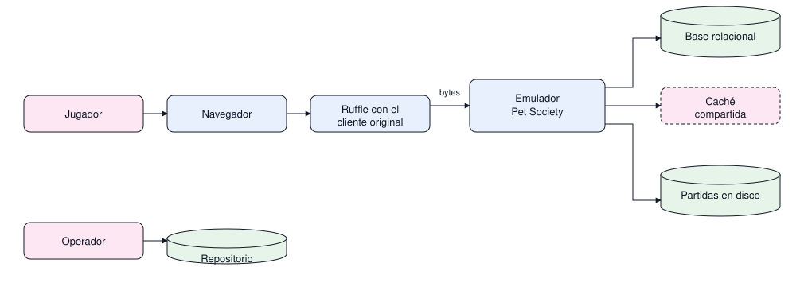
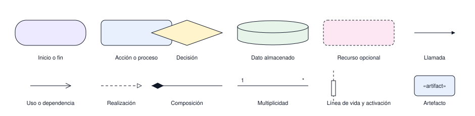

# Arquitectura del emulador

Documento de arquitectura organizado con el modelo 4+1 de Kruchten: cuatro vistas concurrentes más
los escenarios que las validan. Cada vista tiene su carpeta y responde una sola pregunta; ningún
diagrama repite el recorrido de otro. Todo lo que hay acá es documentación de diseño: en esta etapa
no existe código del servidor.

| Vista | Carpeta | Pregunta que responde | Documentos |
|---|---|---|---|
| Escenarios | `escenarios/` | Qué debe hacer el sistema y para quién | Casos de uso |
| Lógica | `logica/` | Qué conceptos existen y cómo se relacionan | Clases del dominio, modelo de datos |
| Proceso | `proceso/` | Qué ocurre en ejecución y en qué orden | Ejecución, protocolo, carga de partida, tienda |
| Desarrollo | `desarrollo/` | Qué artefactos se construyen y qué contrato exponen | Estructura de módulos, flujo de trabajo |
| Física | `fisica/` | Qué artefacto corre en qué nodo | Despliegue |

Los escenarios se dibujan antes que nada porque fijan el alcance; las otras cuatro vistas describen
la misma arquitectura desde el punto de vista de quien la usa, quien la diseña, quien la ejecuta,
quien la programa y quien la instala.

## 1. Contexto del sistema

Pregunta: quién habla con el emulador y de qué recursos depende.

Lectura: el jugador llega por el navegador con Ruffle y el cliente original; el operador configura
el servidor. El emulador es una sola pieza y hacia adentro guarda partidas en disco, y solo al
escalar usa caché compartida y base relacional.

Alcance: no muestra el interior del servidor ni el orden de los mensajes; eso empieza en
[desarrollo/estructura-modulos.md](desarrollo/estructura-modulos.md) y sigue en
[proceso/protocolo.md](proceso/protocolo.md).

## Catálogo

| Documento | Vista | Diagramas |
|---|---|---|
| [escenarios/casos-uso.md](escenarios/casos-uso.md) | Escenarios | Casos de uso |
| [logica/clases-dominio.md](logica/clases-dominio.md) | Lógica | Clases del dominio |
| [logica/modelo-datos.md](logica/modelo-datos.md) | Lógica | Entidades, estado de cuidado, proyección a la base |
| [proceso/ejecucion.md](proceso/ejecucion.md) | Proceso | Ejecución del proceso |
| [proceso/protocolo.md](proceso/protocolo.md) | Proceso | Petición, respuesta, secuencia, estados de un mensaje |
| [proceso/carga-partida.md](proceso/carga-partida.md) | Proceso | Carga de una partida guardada |
| [proceso/tienda.md](proceso/tienda.md) | Proceso | Compra en la tienda |
| [desarrollo/estructura-modulos.md](desarrollo/estructura-modulos.md) | Desarrollo | Componentes y contratos de los paquetes |
| [desarrollo/flujo-trabajo.md](desarrollo/flujo-trabajo.md) | Desarrollo | Ciclo de cambio, etapas e insumos, publicación |
| [fisica/despliegue.md](fisica/despliegue.md) | Física | Nodos y artefactos |

## Cómo se lee cada diagrama

Cada diagrama tiene la misma estructura: un título numerado, la pregunta que responde, el
diagrama y una nota de alcance que dice qué deja fuera. Si un diagrama responde dos preguntas
distintas, se parte en dos.

Reglas de organización:

- Un diagrama por pregunta. El título es una frase, no un nombre de tecnología.
- Un diagrama no repite el recorrido de otro: empieza donde el otro termina y lo nombra en el
  texto. Si dos diagramas muestran los mismos pasos, uno de los dos sobra.
- La numeración es estable dentro de cada documento: si se agrega un diagrama al medio, los
  siguientes se renumeran y se actualiza este índice en el mismo cambio.
- El texto no repite lo que el diagrama ya dice; agrega el porqué o la advertencia.
- Los nombres de caja son conceptos del juego, no clases ni archivos: la documentación no debe
  quedar obsoleta cuando cambie el código.
- Cada diagrama debe poder explicarse en voz alta en menos de un minuto.

## Continuidad entre diagramas

Cada diagrama es una escena de la misma película: el final de uno marca el comienzo del siguiente.

| Termina en | Sigue en | Qué agrega el segundo |
|---|---|---|
| Contexto | Componentes | Qué hay dentro del servidor |
| Componentes | Secuencia del protocolo | Qué hace cada módulo con un mensaje |
| Secuencia del protocolo | Carga de partida | De dónde sale el estado de la mascota |
| Secuencia del protocolo | Despliegue | En qué nodo corre ese recorrido |
| Entidades | Proyección | Cómo se llena la base desde el dominio |
| Entidades | Estado de cuidado | Cómo cambia el cuidado con el tiempo |
| Ciclo de un cambio | Publicación | Qué se revisa antes de entregar |

## Convenciones visuales

El estilo viene del flujo con terminadores, rombos y conectores ortogonales, y del modelo de datos
con tablas de encabezado coloreado. Es plano y limpio: relleno pastel, borde oscuro fino, esquinas
redondeadas, sin numeración de pasos y sin rótulos decorativos sobre las flechas.

Todos los diagramas son SVG dentro de `docs/img`, con la misma paleta y sin renderizador externo. El
relleno es el único código de significado: no se usa para decorar.

| Forma | Significado | Relleno |
|---|---|---|
| Rectángulo redondeado | Inicio o fin del recorrido | Lila |
| Rectángulo | Acción o proceso | Azul claro |
| Rombo | Decisión con dos salidas rotuladas | Amarillo claro |
| Cilindro | Dato almacenado | Verde menta |
| Elipse | Caso de uso | Azul claro |
| Figura de actor | Actor del sistema | Sin relleno |
| Rectángulo de tres franjas | Clase, con nombre, atributos y operaciones | Encabezado azul claro, cuerpo blanco |
| Celdas contiguas con desplazamiento | Estructura de un mensaje binario | Azul claro; el tramo variable, amarillo |
| Rectángulo con línea de vida | Participante de una secuencia | Azul claro |
| Romboide | Entrada o salida | Azul claro |
| Rectángulo de borde discontinuo | Recurso externo u opcional | Rosa |
| Marco sin relleno | Capa o frontera de responsabilidad | Sin relleno |
| Caja 3D con bisel | Nodo de despliegue | Blanco con borde |
| Rombo relleno | Composición: la parte no existe sin el todo | Oscuro |
| Flecha continua con punta abierta | Uso o dependencia de compilación | Trazo oscuro |
| Flecha discontinua con triángulo hueco | Realización de una interfaz | Trazo oscuro |
| Línea vertical discontinua | Línea de vida de un participante | Trazo oscuro |
| Barra angosta sobre la línea de vida | Activación: mientras dura la ejecución | Blanco con borde |
| Etiqueta «artifact», «device», «executionEnvironment» | Artefacto y nodo en el despliegue | Según la caja que rotula |

Reglas de uso:

- Una acción se rotula con un verbo; un dato, con un sustantivo. Nunca se mezclan.
- La decisión lleva el rótulo en las salidas ("sí", "no"), no dentro del rombo.
- La guarda de una transición va siempre entre corchetes: `[tipo conocido]`. Si además hay evento
  y acción, el orden es `evento [guarda] / acción`.
- La multiplicidad de una asociación se escribe con `1`, `*`, `0..1` o `1..*`. Nunca con `N`.
- La dependencia usa punta abierta y la realización triángulo hueco: con punta rellena se lee como
  asociación dirigida, que es otra cosa.
- Los rótulos de prosa llevan tilde y ñ. Los nombres de campo, atributo y clase se escriben en ASCII
  porque son identificadores: `posicion`, `rotacion`, `cumpleanios`.
- El recurso opcional siempre lleva borde discontinuo, para distinguirlo de lo que sí existe siempre.
- Borde oscuro de un píxel y esquinas redondeadas: el trazo grueso ensucia el dibujo.
- Conectores ortogonales cuando el gráfico lo permita. La flecha no lleva rótulo decorativo: solo
  se rotula cuando dice qué dato viaja o qué condición se cumple.
- Sin numeración de pasos salvo que el orden no se deduzca de la forma.
- En diagramas de capas, el color identifica el módulo: rosa para infraestructura, amarillo para
  aplicación, verde para dominio y azul para protocolo. En diagramas de flujo se mantiene la
  paleta por significado de la tabla.
- En tablas de datos, el encabezado lleva el azul claro de la paleta y el cuerpo queda blanco; cada
  campo lleva su tipo a la derecha y se marca como PK o FK cuando corresponda. Minúsculas para
  campos y tipos, mayúsculas para PK y FK.
- La paleta se escribe literal en cada SVG: `#E8F0FE` acción, `#FFF4CC` decisión, `#E6F4EA` dato,
  `#FCE7F3` recurso opcional, `#EDE9FE` inicio o fin, borde y texto `#111827` de un píxel.
- Si un diagrama necesita una forma o un color que no están en esta tabla, se agregan acá en el
  mismo cambio.

## Cómo se pide un diagrama

Sirve tanto para pedírselo a una persona como a una herramienta de IA: la calidad del diagrama
depende de la calidad del pedido.

- Decir el objetivo antes que la forma: qué decisión o duda debe resolver el diagrama.
- Ser específico con el alcance: qué entra, qué queda fuera y qué nivel de detalle se espera.
  "Un diagrama del juego" no sirve; "cómo se carga una partida guardada hasta ver a la mascota"
  sí.
- Escribir en lenguaje natural y en frases completas, como se le explicaría a un colega.
- Pedir un diagrama a la vez y una sola pregunta por diagrama. Si aparecen dos preguntas, se
  parten.
- Iterar: el primer resultado es un borrador. Se ajusta con pedidos concretos ("separa el
  rechazo del camino exitoso", "agrega qué pasa si la sesión no existe") en lugar de rehacer
  todo.
- Cerrar con la nota de alcance: qué deja fuera el diagrama y dónde se resuelve eso.
- Pedir el resultado como SVG en `docs/img` con la paleta de la tabla, no como diagrama generado en
  el momento: así se ve igual en el editor, en GitHub y en cualquier navegador.

## Qué tipo de diagrama usar

| Pregunta | Tipo | Vista |
|---|---|---|
| Quién usa el emulador y para qué | Casos de uso | Escenarios |
| Qué conceptos existen y qué saben hacer | Clases | Lógica |
| Qué datos existen y cómo se relacionan | Entidades y relaciones | Lógica |
| En qué orden ocurren los intercambios entre partes | Secuencia | Proceso |
| Cómo cambia una cosa con el tiempo | Estados | Proceso |
| Qué artefacto se construye y qué contrato expone | Componentes | Desarrollo |
| Qué camino toma una decisión | Flujo con decisiones | Desarrollo |
| Qué artefacto corre en qué nodo | Despliegue | Física |

## Cómo se revisa un diagrama

- ¿Responde exactamente la pregunta del título?
- ¿Cada caja tiene un nombre que un jugador reconocería, no un nombre de clase?
- ¿Cada flecha usa la punta que le corresponde: rellena para llamada, abierta para dependencia,
  triángulo hueco para generalización o realización?
- ¿Cada asociación lleva multiplicidad, y cada transición su guarda entre corchetes?
- ¿Las flechas son coherentes y sin cruces innecesarios?
- ¿El texto alrededor aporta algo que el dibujo no dice?
- ¿Se entiende sin la explicación oral de quien lo hizo?

## Qué falta diagramar

- Ciclo de vida de la sesión, del alta al cierre, con su rechazo.
- Guardado y salida: qué se escribe, cuándo y en qué orden.
- Modelo entidad-relación físico, con claves e índices declarados.

Descartados a propósito: flujo de datos de nivel 0 y 1, despliegue con nodos reales de producción y
recorrido del jugador, porque repiten lo que ya está en contexto, despliegue y casos de uso. El
diagrama de paquetes tampoco va aparte: en un monolito modular coincide con el de componentes.

## Orden de lectura sugerido

1. Escenarios, para saber qué debe hacer el sistema.
2. Lógica, para saber con qué conceptos se trabaja.
3. Proceso, para entender el único contrato que no se puede romper.
4. Desarrollo, para saber qué se construye y en qué orden.
5. Física, para saber dónde corre todo eso.
