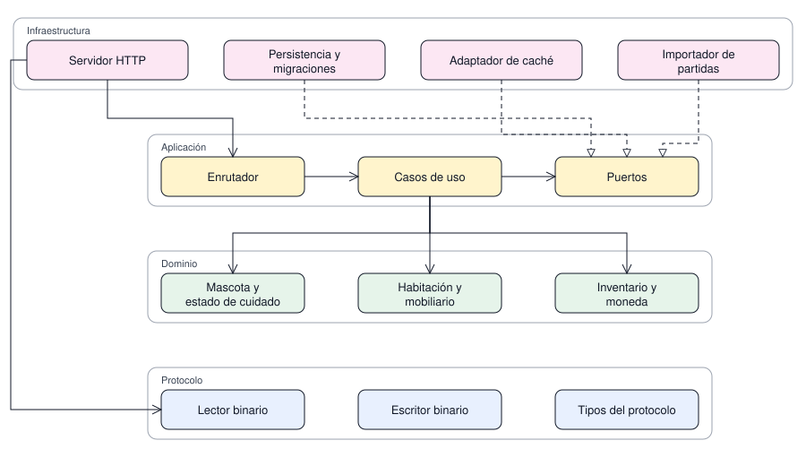

# Estructura de los módulos

Cómo se compone el monolito modular, qué módulo puede conocer a cuál y qué contrato expone cada
uno. Es la vista de desarrollo: describe artefactos de software, no nodos ni mensajes. Un proceso,
un artefacto y un solo punto de arranque.

| # | Diagrama | Pregunta que responde |
|---|---|---|
| 1 | Componentes | Qué módulo existe y qué módulo puede conocer a cuál |

## 1. Componentes y dirección de dependencias

Pregunta: qué módulo puede conocer a cuál.

Lectura: la flecha continua con punta abierta es uso o dependencia de compilación; la discontinua
con triángulo hueco es realización del puerto correspondiente. El dominio no aparece apuntando
hacia afuera, y las herramientas quedan fuera del dibujo porque no forman parte del artefacto que
se publica. El color identifica el módulo: rosa para infraestructura, amarillo para aplicación,
verde para dominio y azul para protocolo.

Alcance: no muestra paquetes por nombre ni firmas de las interfaces; eso está en la tabla
siguiente. Las prohibiciones concretas están en el manual del proyecto.

## 2. Paquetes y contratos

El diagrama de componentes y el de paquetes quedan en uno solo: en un monolito modular cada paquete
corresponde a un módulo compilable, y dibujarlos por separado repetiría las mismas cajas con otro
nombre. Lo que el dibujo no dice —el nombre del paquete y el contrato que expone— va en esta tabla,
en lugar de rotular cada flecha.

| Paquete | Contiene | Expone | Exige |
|---|---|---|---|
| protocolo | lector y escritor binario, tipos del protocolo | lectura y escritura de bytes | nada |
| dominio | mascota, cuidado, habitación, inventario, moneda | reglas del juego en estado puro | nada |
| aplicacion | enrutador, casos de uso, puertos | interfaces de los puertos | dominio, protocolo |
| infraestructura | servidor HTTP, persistencia, caché, importador | implementación de los puertos | aplicacion, dominio |
| herramientas | inspección y reparación de partidas | ninguna: se ejecuta por fuera | protocolo, dominio |

Los puertos que la aplicación declara y la infraestructura implementa son el repositorio de
partidas, la caché de sesión y el analizador binario. La aplicación nunca nombra una clase de
infraestructura: pide la interfaz y la implementación entra por configuración.

Nadie depende de las herramientas y las herramientas no se publican con el servidor: si un día
dejan de existir, el juego sigue funcionando.

Pendiente de definir: el nombre raíz de los paquetes se fija cuando exista el archivo de
compilación, en la etapa de estructura del repositorio.
