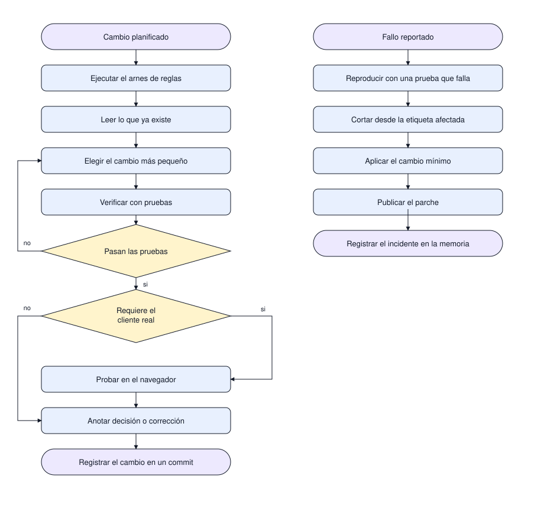
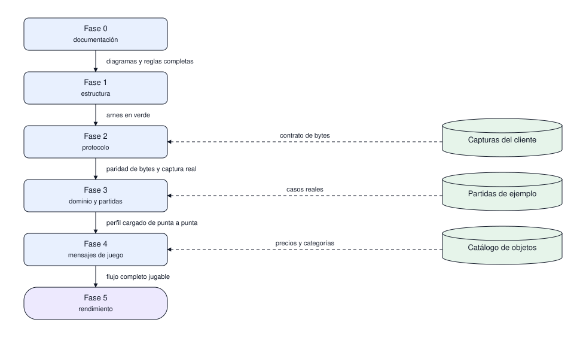
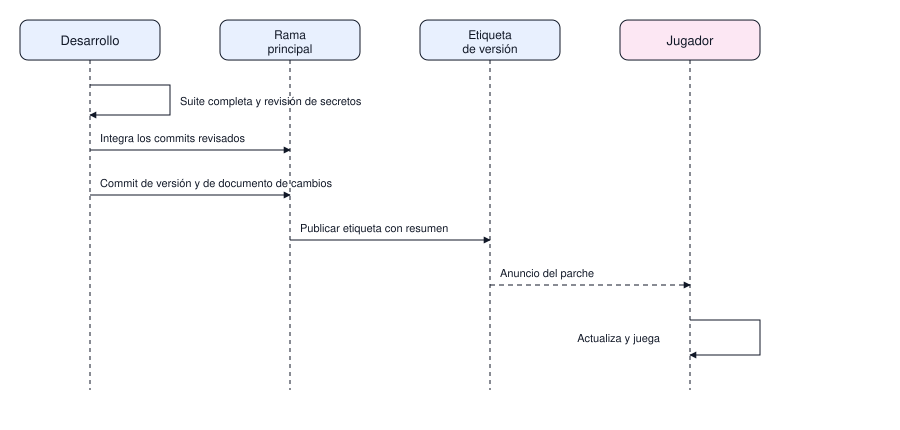

# Flujo de trabajo

Cómo se mueve un cambio desde la idea hasta el parche publicado, y qué se exige en cada puerta. La
historia del repositorio es parte del producto: se lee como una lista de cambios, un commit por
entrada visible.

| # | Diagrama | Pregunta que responde |
|---|---|---|
| 1 | Ciclo de un cambio | Qué pasos sigue un cambio y qué pasa cuando el fallo ya está en producción |
| 2 | Etapas e insumos | Qué falta para abrir cada fase y qué la desbloquea |
| 3 | Publicación | Qué se revisa antes de entregar un parche |

## 1. Ciclo de un cambio

Son dos entradas del mismo ciclo. La izquierda es el cambio planificado: se lee lo que existe, se
elige el cambio más pequeño, se prueba y se anota. La derecha es el fallo que ya llegó al jugador:
primero se reproduce con una prueba que falla, después se corta desde la etiqueta afectada.

La corrección urgente no tiene diagrama propio porque no es otro proceso: cambia el punto de
partida y el destino, no los pasos. En ambos casos el trabajo termina escribiendo qué se aprendió,
porque un fallo sin registro se repite.

Alcance: el ciclo termina en el commit local. El envío al remoto, la etiqueta y el anuncio son el
diagrama 3.

## 2. Etapas e insumos

El rótulo sobre cada flecha es la prueba de salida: ninguna fase se abre por tiempo transcurrido,
se abre cuando esa prueba existe y pasa. Los cilindros de la derecha son insumos que no bloquean el
diseño pero sí el cierre: sin captura real no se aprueba el protocolo, y sin partidas de ejemplo el
dominio se prueba con datos inventados.

## 3. Publicación de un parche

Supone que el ciclo de cambio ya dejó los commits en la rama principal; por eso no repite la
lectura, las pruebas locales ni la anotación de decisiones.

## Ramas

`main` solo recibe cortes: lo que se entrega como versión. Ningún trabajo entra ahí directo.
`develop` es la rama de integración y el destino normal de cada cambio; vive siempre en verde.

| Rama | Vive | Nace de | Vuelve a |
|---|---|---|---|
| `main` | siempre | — | — |
| `develop` | siempre | `main` | `main` en cada corte |
| `feature/hN-nombre` | la fase Hn | `develop` | `develop` |
| `fix/nombre` | hasta el parche | `develop` | `develop` |
| `docs/nombre` | hasta la revisión | `develop` | `develop` |
| `release/hN` | el corte | `develop` | `main` y `develop` |

Reglas:

- Una rama por cambio y se borra al integrar; el nombre va en minúsculas, con guion, y dice qué
  entrega: `feature/h1-esqueleto`, `docs/protocolo`, `fix/lector-longitud`.
- El número del hito en la rama de fase permite leer el avance en la lista de ramas.
- `develop` pasa a `main` solo con un corte cerrado y verificado, nunca a mitad de una fase.
- Nada de `--force` en `main` ni en `develop`.
- Revisar un cambio es comparar su rama contra `develop`, no contra `main`.

## Reglas de la historia

- Un commit por entrada visible: cada archivo de la raíz va solo, cada documento de `docs/` va con
  sus diagramas.
- Mensajes en infinitivo, en español, una línea, sin punto final y sin repetirse entre commits.
- Nada de reescribir historia ya publicada sin autorización explícita.
- Todo commit publicado deja `develop` ejecutable; `main` solo recibe cortes.
