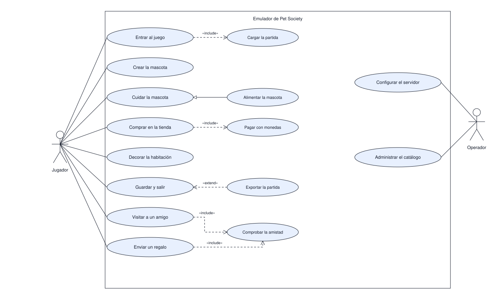

# Casos de uso

Qué puede hacer cada actor y qué busca con ello, desde el punto de vista de quien usa el sistema.
Es el alcance funcional: lo que no aparezca acá no se implementa en las primeras fases.

| # | Diagrama | Pregunta que responde |
|---|---|---|
| 1 | Casos de uso | Quién usa el emulador y para qué |

## 1. Casos de uso

El rectángulo es el límite del sistema: todo lo que está dentro lo resuelve el emulador, y los
actores quedan afuera porque son el entorno. Las elipses se nombran con un verbo en infinitivo y
describen una tarea completa, no un mensaje ni una función.

El jugador persigue ocho objetivos: seis sobre su propia mascota —entrar, crearla, cuidarla,
comprar, decorar su habitación y salir guardando— y dos que lo conectan con otro jugador, visitar a
un amigo y enviarle un regalo. El operador queda del otro lado, con dos objetivos de configuración
que no tocan la partida de nadie.

Relaciones del diagrama:

| Relación | Se lee | Ejemplo |
|---|---|---|
| Asociación | El actor participa en ese caso de uso | El jugador y Comprar en la tienda |
| Inclusión | El caso de uso exige otro para completarse | Visitar a un amigo exige Comprobar la amistad |
| Extensión | Comportamiento opcional, bajo una condición | Exportar la partida extiende Guardar y salir |
| Generalización | Un caso de uso es una forma especial de otro | Alimentar la mascota es una forma de Cuidar la mascota |

La diferencia importa al implementar: lo incluido siempre ocurre y se prueba en todos los caminos;
lo que extiende puede no ocurrir nunca y se prueba aparte.

Visitar y regalar comparten la misma puerta: sin amistad vigente no hay caso de uso, y por eso los
dos incluyen Comprobar la amistad en lugar de repetir la regla. El amigo no necesita estar
conectado; la visita funciona igual con su partida guardada y el regalo espera en su buzón. El
regalo no se cobra: sale del inventario de quien lo envía.

Nota: la amistad se comprueba contra los datos guardados, no contra la conexión. El emulador sigue
operando con una sola cuenta en línea, y eso mantiene el alcance pequeño.

Alcance: no muestra el orden de los mensajes ni el código. La secuencia de un mensaje está en
[protocolo.md](../proceso/protocolo.md) y cada caso de uso concreto se detalla en su propio documento,
como [carga-partida.md](../proceso/carga-partida.md) y [tienda.md](../proceso/tienda.md).
