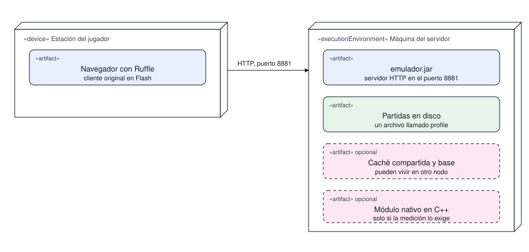

# Despliegue

En qué nodo corre cada artefacto y por dónde se conectan. Es la vista física: describe la
topología, no la lógica ni el orden de los mensajes.

| # | Diagrama | Pregunta que responde |
|---|---|---|
| 1 | Despliegue | Qué artefacto corre en qué nodo y por dónde se conectan |

## 1. Despliegue

Pregunta: qué artefacto corre en qué nodo y por dónde se conectan.

Lectura: dos nodos. La estación del jugador solo aporta el navegador con Ruffle y el cliente
original; toda la lógica vive en la máquina del servidor, donde el mismo proceso Java atiende el
HTTP y lee la partida de un archivo llamado `profile`. La conexión es HTTP en el puerto 8881, que
es un valor de configuración: si el puerto ocupa, se cambia sin tocar el dibujo.

Los artefactos de borde discontinuo son opcionales y pueden vivir en otro nodo. La caché compartida
y la base relacional solo aparecen cuando se escala; el módulo nativo solo entra si la medición
muestra que el analizador en Java no alcanza, y siempre con su respaldo en Java disponible.

Alcance: no muestra los actores ni los recursos externos, que están en el contexto del
[índice](../README.md), ni el orden de los mensajes, que está en
[protocolo.md](../proceso/protocolo.md).
