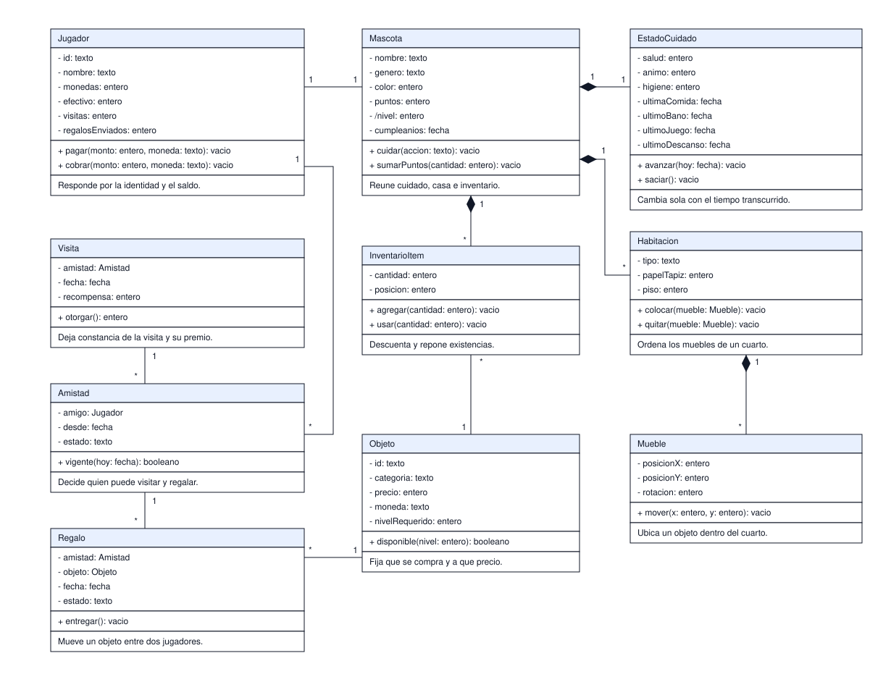

# Clases del dominio

Qué conceptos viven en el dominio, qué guardan, qué saben hacer y de qué responden. Es el
diagrama que se traduce a paquetes cuando se escriba el código; hoy sirve para discutir reglas sin
escribir Java.

| # | Diagrama | Pregunta que responde |
|---|---|---|
| 1 | Clases del dominio | Qué conceptos existen, qué datos guardan y qué operaciones tienen |

## 1. Clases del dominio

Cada clase ocupa cuatro franjas: nombre, atributos, operaciones y responsabilidad. La cuarta no es
UML: se agrega porque el nombre de una clase no dice qué debe resolver, y una clase sin
responsabilidad clara termina haciendo de todo. El signo menos marca lo privado y el más lo
público; la barra inclinada marca un atributo derivado, como `/nivel`, que se calcula desde
`puntos` y no se guarda.

El rombo relleno marca composición: el estado de cuidado, la habitación, el mueble y el objeto de
inventario no existen sin su dueño, así que no se crean ni se borran por separado. Las líneas sin
rombo son asociaciones: el catálogo define qué objeto puede comprarse, pero no depende de la
mascota; una amistad apunta al jugador, y la visita y el regalo cuelgan de la amistad porque solo
se visita o se regala a un amigo. Las tres sobreviven a la mascota.

El cuidado guarda tres valores y cuatro sellos de tiempo, uno por necesidad. Con un solo sello,
bañar a la mascota reiniciaría también el hambre y el sueño, y el estado dependería del último
cuidado en vez del último cuidado de cada cosa. `avanzar` recibe la fecha de hoy y descuenta cada
necesidad desde su propio sello.

El jugador tiene dos saldos, `monedas` y `efectivo`, porque la tienda cobra en una u otra según el
objeto; la operación `pagar` recibe cuál de las dos se descuenta. No se crea una clase `Moneda`:
las dos se comportan igual y solo cambian de nombre.

Los tipos son conceptos, no tipos del motor: `texto`, `entero`, `fecha` y `booleano` se traducen a
la base en las migraciones y a Java en el código.

Alcance: no muestra paquetes, interfaces ni la capa de aplicación, y el nombre de cada operación
describe la regla, no la firma definitiva.

## Reglas que no se negocian

- Todo cambio de estado pasa por una operación del dominio; no hay setters públicos.
- El dominio no conoce la base, ni el archivo `.pet`, ni la sesión del jugador.
- Los identificadores se generan en el dominio: la persistencia solo los almacena.
- `pagar` y `cobrar` rechazan el cambio antes de tocar la base; ningún saldo queda negativo.
- `avanzar` recibe la fecha de hoy, no lee el reloj: así una partida guardada se comporta igual al
  reabrirse.
- Visitar y regalar exigen una amistad vigente; el regalo no descuenta saldo, solo mueve el objeto.
- Una visita se registra una vez por amigo y por día; la recompensa sale de configuración.

## Pendiente de definir

- Si el jugador tiene una mascota o varias, y qué pasa con el inventario al cambiar de mascota.
- Si la sesión pertenece al dominio o solo a la aplicación.
- Si el catálogo es dominio o solo configuración de lectura.
