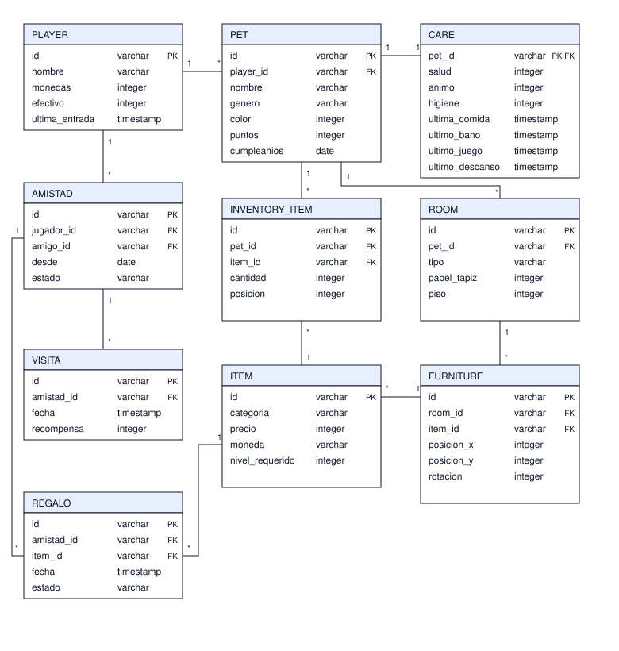
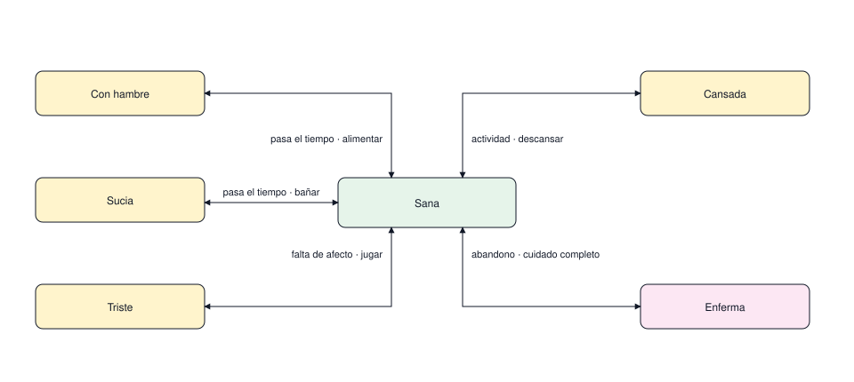
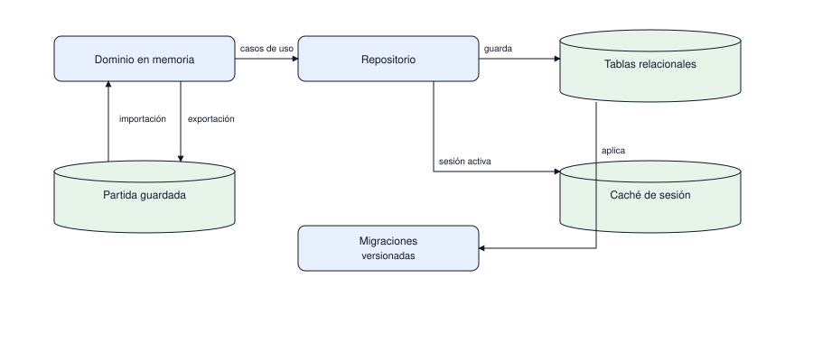

# Modelo de datos

Qué datos existen, cómo cambian y cómo se proyectan a la base y al archivo de partida. El modelo
se piensa primero en el dominio y después se guarda.

| # | Diagrama | Pregunta que responde |
|---|---|---|
| 1 | Entidades | Qué cosas existen y cómo se relacionan |
| 2 | Estado de cuidado | Cómo evoluciona la mascota con el tiempo |
| 3 | Proyección | De dónde salen los datos y a dónde van |

## 1. Entidades

Cada tabla lleva el encabezado en azul claro, borde oscuro y cuerpo blanco. El nombre del campo va
en minúsculas y el tipo en minúsculas, con PK o FK a la derecha; la cardinalidad se rotula en los
extremos de cada relación.

La amistad es la puerta de lo social: una visita y un regalo cuelgan de ella, no del jugador
suelto, porque solo se puede visitar o regalar a un amigo. El catálogo se comparte entre todos y
por eso `ITEM` no guarda dueño; `moneda` decide si el precio se paga con monedas o con efectivo.

`CARE` guarda un sello por necesidad, no uno solo: bañar a la mascota no debe reiniciar el hambre ni
el sueño. Con esos cuatro sellos el estado se recalcula al responder sin guardar de nuevo.

Alcance: no define índices, restricciones de unicidad ni tipos concretos del motor; eso se decide
en las migraciones.

## 2. Estado de cuidado

Nota: las transiciones dependen del tiempo transcurrido, no de la hora del servidor. Una partida
guardada debe comportarse igual al reabrirse.

## 3. Proyección del estado

El archivo de partida y la base no compiten: el archivo conserva compatibilidad con el juego
original y la base aporta consultas y respaldo. La conversión ocurre en infraestructura y el
dominio nunca sabe de dónde vino el dato.

## Reglas que no se negocian

- Ningún identificador se genera fuera del dominio: la persistencia solo lo almacena.
- Ningún saldo queda negativo; el dominio rechaza el cambio antes de llegar a la base.
- Las cantidades y precios salen de configuración o del catálogo, nunca de constantes en el
  código.
- Toda tabla con datos de jugador debe explicarse con una migración versionada.

## Pendiente de definir

- Si una cuenta puede tener más de una mascota o si la partida es siempre individual.
- Cómo se representan los objetos de paquete que no existen en el catálogo.
- Estrategia cuando la partida guardada trae datos que la versión nueva no conoce.
- Qué pasa con la amistad cuando uno de los dos jugadores se da de baja.
