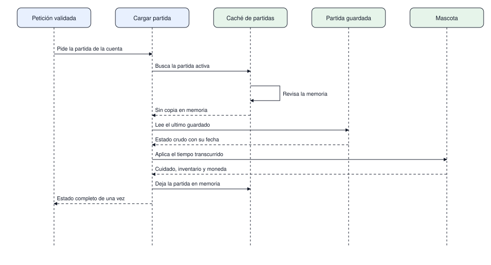

# Carga de una partida guardada

El primer caso de uso real: la petición ya pasó el protocolo y el servidor tiene que devolver la
mascota tal como quedó la última vez. Este diagrama empieza donde termina
[protocolo.md](protocolo.md): no repite el viaje de los bytes, solo decide de dónde sale el estado.

| # | Diagrama | Pregunta que responde |
|---|---|---|
| 1 | Carga de partida | De dónde sale el estado de la mascota y cómo se arma la respuesta |

## 1. Carga de partida

La caché se consulta primero. Si la partida está en memoria no se toca el disco, pero el estado del
cuidado se recalcula igual: el tiempo que pasó desde el último guardado se aplica al responder, no
al guardar. Esa decisión evita reescribir el archivo en cada petición y mantiene la salud, la
higiene y el ánimo correctos aunque el jugador lleve días sin entrar.

La lectura del archivo ocurre una sola vez por sesión, y la respuesta viaja completa: mascota,
inventario, habitación, saldos y la lista de amigos. Separarlas obligaría al cliente a pintar una
pantalla a medio armar y a pedir la partida por partes, algo que el cliente original nunca hizo. La
lista de amigos viaja con la partida porque las visitas y los regalos se resuelven contra ella, sin
depender de que el otro jugador esté conectado.

Alcance: cuenta que ya existe y archivo que se puede leer. La creación de la mascota, el rechazo por
sesión inválida y la recuperación de un archivo dañado se tratan en el ciclo de vida de la sesión y
en los estados de una petición.
