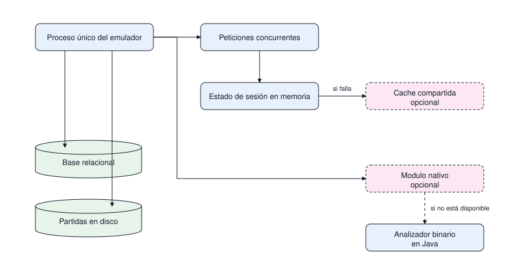

# Ejecución del proceso

Qué ocurre dentro del emulador mientras está encendido: qué vive en memoria, qué es opcional y en
qué orden se escala. Responde al comportamiento en ejecución, no al orden de los mensajes.

| # | Diagrama | Pregunta que responde |
|---|---|---|
| 1 | Ejecución | Qué corre dentro del proceso y qué es opcional |

## 1. Ejecución del proceso

Pregunta: qué corre dentro del proceso y qué es opcional.

Lectura: un solo proceso atiende las peticiones concurrentes de los jugadores conectados. El estado
de la sesión activa vive en memoria del proceso; los recursos de borde discontinuo solo existen en
producción y el módulo nativo entra únicamente si la medición muestra que el analizador en Java no
alcanza.

Alcance: no muestra el orden de los mensajes, que está en [protocolo.md](protocolo.md), ni en qué
nodo corre el proceso, que está en [despliegue.md](../fisica/despliegue.md).

## Escalado sin partir el sistema

Primero se mide, después se optimiza. El orden previsto es caché en memoria del proceso, caché
compartida entre nodos, índices y réplicas de lectura en la base, y por último el módulo nativo en
las rutas que la medición señale como costosas. Partir el monolito en servicios no está en el plan.
