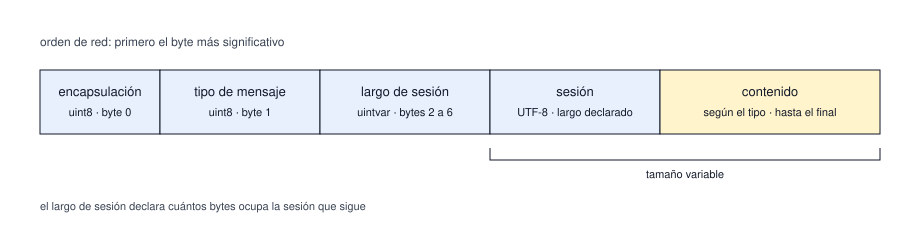
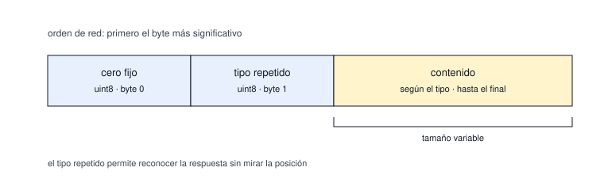
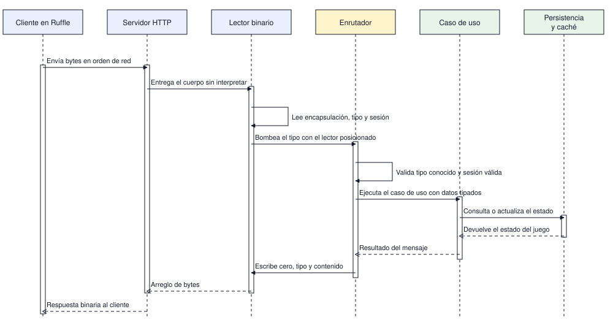
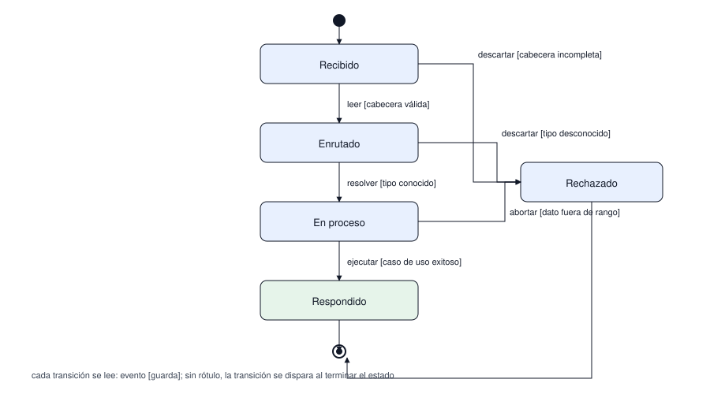

# Protocolo binario

El contrato que no se puede romper: el cliente original espera exactamente estos bytes. Los números
fijos viajan en orden de red, con el byte más significativo primero; los variables van en base 128.

| # | Diagrama | Pregunta que responde |
|---|---|---|
| 1 | Petición | Qué bytes manda el cliente y en qué orden |
| 2 | Respuesta | Qué bytes devuelve el servidor |
| 3 | Secuencia | Qué hace el servidor con esos bytes |
| 4 | Estados | Qué estados atraviesa una petición y cuándo se rechaza |

## 1. Petición del cliente

Las dos primeras láminas son un mapa de bytes, no un flujo: los campos van contiguos y el
desplazamiento se lee de izquierda a derecha. No llevan flechas porque el orden no depende de la
ejecución sino de la posición: el byte 0 es siempre la encapsulación y el byte 1, el tipo.

Alcance: el contenido varía por tipo de mensaje; este diagrama solo fija la cabecera.

## 2. Respuesta del servidor

La respuesta empieza con un byte en cero, repite el tipo de la petición y sigue con el contenido.
El cliente se guía por el tipo repetido, no por la posición: si no coincide con la petición,
descarta la respuesta.

## 3. Secuencia de una petición

Alcance: muestra el camino de un mensaje simple. El cliente también agrupa mensajes en el tipo
255: un modo, la cantidad y pares de tipo con su bloque. La respuesta repite el tipo de cada
sub-mensaje y un sub-mensaje que falla no tumba el lote. El orden se lee de arriba hacia abajo, por
eso no lleva numeración.

## 4. Estados de una petición

Nota: el rechazo siempre devuelve una respuesta; dejar al cliente sin respuesta lo bloquea.

Un mensaje no se da por terminado porque compile: necesita ida y vuelta idéntica y una captura real
del cliente. Esa puerta de salida se explica en
[flujo-trabajo.md](../desarrollo/flujo-trabajo.md).

## Tipos del protocolo

| Tipo | Tamaño | Notas |
|---|---|---|
| uint8 | 1 byte | Valores de 0 a 255 |
| int8 | 1 byte | Valores de -128 a 127 |
| uint16 | 2 bytes | Coordenadas y contadores cortos |
| int16 | 2 bytes | Diferencias de posición |
| uintvar | 1 a 5 bytes | Entero sin signo en base 128 |
| intvar | 1 a 5 bytes | Entero con signo, codificado en zigzag |
| int32 | 4 bytes | Identificadores y saldos |
| float | 4 bytes | Punto flotante de precisión simple |
| cadena | 1 a 5 + n bytes | Largo en uintvar, en caracteres, y contenido UTF-8 |
| bytes | 1 a 5 + n bytes | Largo en uintvar y bloque de ese tamaño |

## Decisiones abiertas

- Qué identifica una sesión: hoy el servidor repite el texto que manda el cliente y no guarda
  estado propio, así que la reutilización entre conexiones queda por definir.
- Comportamiento ante un tipo desconocido: respuesta vacía o cierre explícito.
- Si un lote puede mezclar mensajes de lectura y de escritura en el mismo envío.
