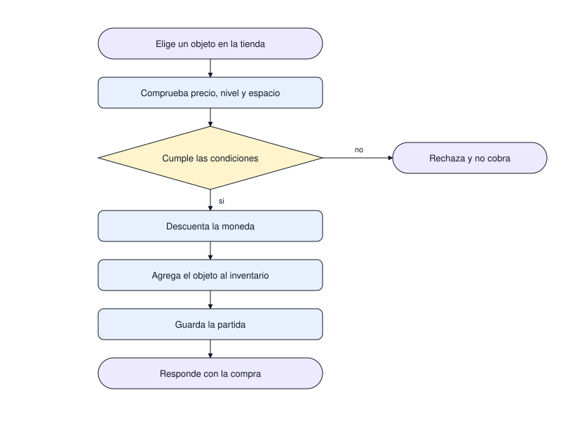

# Compra en la tienda

Qué ocurre desde que el jugador elige un objeto hasta que ese objeto está en su inventario, y qué
garantiza que nunca se cobre sin entregar.

| # | Diagrama | Pregunta que responde |
|---|---|---|
| 1 | Compra en la tienda | En qué orden se comprueba, se cobra y se guarda una compra |

## 1. Compra en la tienda

El orden no es negociable: primero se comprueba todo junto —precio, nivel del jugador y espacio en
el inventario— y solo después se descuenta la moneda. Cobrar primero y validar después dejaría
compras a medias si algo falla.

El catálogo decide con qué se paga: monedas o efectivo. Son dos saldos separados y una compra
descuenta de uno solo; mezclarlos dejaría al jugador pagando con lo que no eligió.

La partida se guarda antes de responder. Si el servidor se cae entre el cobro y la respuesta, el
objeto ya está escrito y el jugador no pierde lo que pagó; el precio es que puede recibir un error y
volver a intentar, y por eso un reintento no debe cobrar dos veces.

Alcance: no muestra el catálogo ni cómo se cargan los precios; eso vive en el modelo de datos y en
el catálogo de objetos. Cómo tratar el reintento del cliente sigue abierto: el diagrama dibuja una
compra, no la repetición de la misma.
